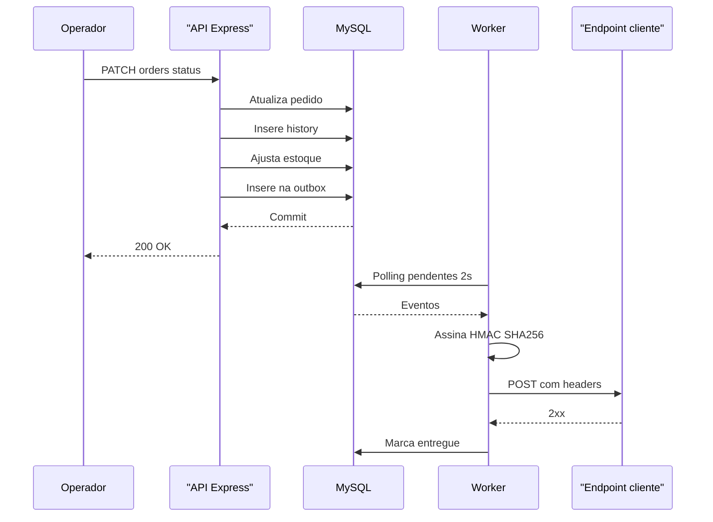
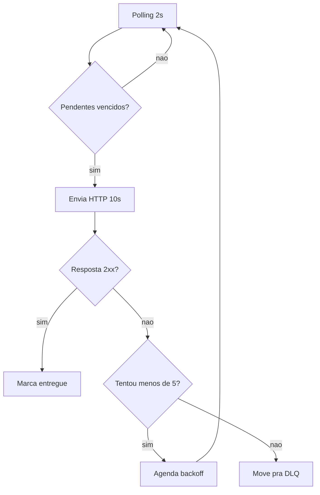
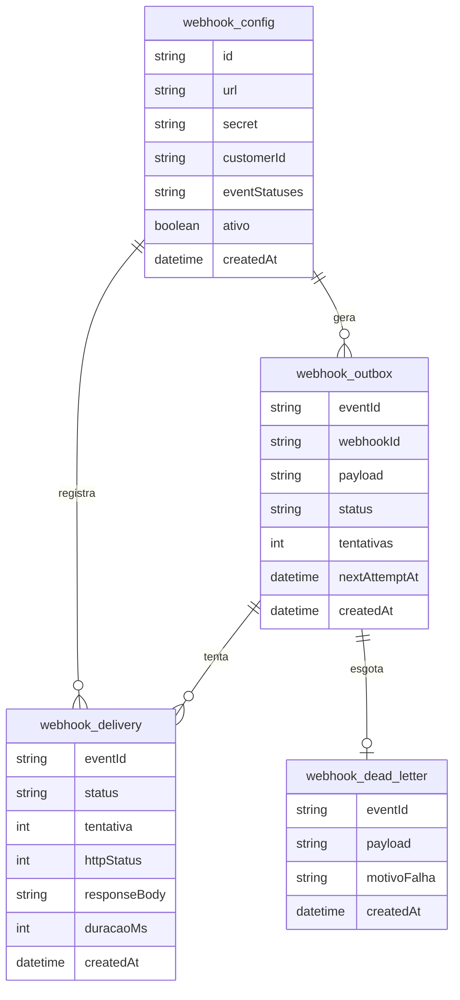

# FDD: Sistema de Webhooks de Notificação de Pedidos

**Versão:** 1.0
**Data:** 2026-11-22
**Responsável:** Bruno (Engenheiro Pleno, time de Pedidos)
**Documentos relacionados:** [RFC](RFC.md), [ADR-001](adrs/ADR-001-outbox-no-mysql.md), [ADR-002](adrs/ADR-002-retry-com-backoff-e-dlq.md), [ADR-003](adrs/ADR-003-hmac-sha256-com-secret-por-endpoint.md), [ADR-004](adrs/ADR-004-garantia-at-least-once-com-x-event-id.md), [ADR-005](adrs/ADR-005-worker-separado-em-polling.md), [ADR-006](adrs/ADR-006-reuso-dos-padroes-existentes.md), [ADR-007](adrs/ADR-007-snapshot-do-payload-na-insercao.md)

---

## 1. Contexto e motivação técnica

O OMS não tem hoje nenhum mecanismo de notificação externa. Clientes B2B consultam mudança de status por polling no endpoint de listagem de pedidos; para eles, "tempo real" é qualquer entrega abaixo de 10 segundos [09:02] Marcos. A feature entrega `order.status_changed` para endpoints HTTPS cadastrados pelos próprios clientes.

O ponto técnico central é a transação de mudança de status: `changeStatus` em `src/modules/orders/order.service.ts` já faz, numa única transação, update do pedido, insert no histórico e ajuste de estoque [09:40] Bruno. Disparar HTTP dentro desse fluxo foi descartado [09:03]-[09:04] Bruno; a saída é o padrão outbox: insert da linha do evento na mesma transação, com entrega feita depois por um worker em processo separado [09:06] Diego. As decisões de arquitetura estão registradas nos ADRs; este FDD especifica o comportamento implementável.

**Atores:**
- Usuários do OMS (roles ADMIN e OPERATOR) autenticados por JWT, que gerenciam os cadastros de webhook via API [09:32] Marcos, [09:37] Sofia
- Processo worker (`src/worker.ts`, a criar), que consome a outbox e faz as chamadas HTTP [09:11] Larissa/Diego
- Endpoints dos clientes B2B, receptores dos eventos, sem autenticação de usuário; validam a assinatura HMAC [09:20] Sofia

**Limites:** apenas eventos de saída (`order.status_changed`); o cliente nunca envia eventos para a plataforma [09:02] Sofia/Marcos.

---

## 2. Objetivos técnicos

- **Atomicidade do evento:** status alterado implica linha na `webhook_outbox` na mesma transação; rollback do status remove o evento junto [09:40]-[09:41] Bruno/Diego. Invariante, sem exceção.
- **Latência de entrega:** evento entregue abaixo de 10 segundos contados do commit da transação [09:02] Marcos; com polling de 2s, a latência mínima no pior caso é de 2 segundos [09:09]-[09:10] Diego/Larissa.
- **Resiliência de entrega:** até 5 tentativas por evento com backoff de 1m/5m/30m/2h/12h; esgotadas, o evento é persistido na `webhook_dead_letter` e nunca descartado [09:17]-[09:18] Diego.
- **Autenticidade e integridade:** todo envio assinado com HMAC-SHA256 sobre o corpo, com secret por endpoint [09:20]-[09:22] Sofia.
- **Semântica declarada:** entrega at-least-once, com `X-Event-Id` para deduplicação no cliente [09:24]-[09:25] Diego.
- **Rastreabilidade:** cada tentativa de entrega registrada com status, payload, response e tempo de resposta, consultável pelos últimos 100 por webhook [09:34] Marcos.

---

## 3. Escopo e exclusões

**Incluído**
- Módulo `src/modules/webhooks` (controller, service, repository, routes, schemas) [09:27] Bruno
- Entry `src/worker.ts` com script `npm run worker` e lógica de processamento no módulo [09:11] Larissa, [09:28] Bruno
- Tabelas `webhook_outbox`, `webhook_dead_letter` e modelos de configuração e histórico de entregas no `prisma/schema.prisma` [09:06] Diego, [09:18] Diego, [09:21] Bruno
- CRUD de configuração, rotação de secret, histórico de entregas e replay de DLQ [09:31]-[09:36]
- Integração no `changeStatus` via `publishWebhookEvent` [09:41] Bruno/Diego
- Assinatura HMAC-SHA256 com headers de envio [09:20] Sofia, [09:44]-[09:45] Diego/Sofia

**Excluído**
- Notificação por email quando o webhook do cliente falha repetidamente [09:37] Larissa
- Dashboard visual para o cliente; apenas endpoints, painel é projeto do time de frontend [09:40] Larissa
- Rate limiting de envio; observar em produção e decidir depois [09:39] Diego/Larissa
- Arquivamento de linhas entregues da outbox após 30 dias [09:08] Diego
- Escala para múltiplos workers; ordering global [09:13] Diego
- Webhooks de entrada (inbound) [09:02] Sofia/Marcos

---

## 4. Fluxos detalhados e diagramas

**Fluxo principal (status mudou até entrega)**

1. Operador chama `PATCH /api/v1/orders/:id/status` com `toStatus` e `reason`.
2. `changeStatus` abre a transação: valida a transição com `canTransition`, debita/repõe estoque, atualiza o pedido e insere no histórico (`src/modules/orders/order.service.ts:126`).
3. Ainda dentro da mesma transação, o service chama `publishWebhookEvent(tx, order, fromStatus, toStatus)` [09:41] Bruno/Diego.
4. A função consulta os webhooks ativos do customer e filtra pelos que ouvem `toStatus`; se nenhum webhook ouve o status, nenhuma linha é inserida [09:33]-[09:34] Marcos/Bruno/Diego.
5. Para cada webhook que passa o filtro, renderiza o payload snapshot com o estado do pedido no momento da mudança, gera `event_id` (UUID), e insere a linha em `webhook_outbox` com status pendente [09:51]-[09:52] Larissa/Bruno, [09:08] Diego.
6. Commit. A partir daqui o evento existe e não se perde.
7. O worker, em loop de polling de 2s, busca os eventos pendentes mais antigos em batch pequeno e marca como processando [09:08]-[09:09] Diego.
8. Para cada evento, o worker monta o payload do snapshot, assina com HMAC-SHA256 usando a secret do webhook e faz POST para a URL cadastrada com timeout de 10 segundos [09:20] Sofia, [09:42] Diego.
9. Resposta 2xx marca o evento como entregue e registra a entrega com payload, response e tempo de resposta [09:34] Marcos.

**Fluxos alternativos e exceções**

- **Falha de entrega:** resposta não-2xx ou timeout de 10s conta como falha; o evento volta para pendente com `next_attempt_at` conforme o backoff e o contador de tentativas incrementado [09:42] Diego, [09:15]-[09:17] Diego.
- **Esgotamento de tentativas:** na 5ª falha, o evento é movido para `webhook_dead_letter` com payload, motivo da falha e timestamp; a linha sai da leitura principal do worker [09:17]-[09:18] Diego.
- **Replay administrativo:** ADMIN chama `POST /api/v1/admin/webhooks/dead-letter/:id/replay`; o evento volta para a outbox como pendente com contador zerado; o replay é logado para auditoria [09:18] Diego, [09:35]-[09:36] Diego/Sofia.
- **Rotação de secret:** cliente pede nova secret; a antiga continua válida por 24 horas em paralelo e depois é desativada [09:21] Sofia.
- **Worker fora do ar:** eventos pendentes permanecem na outbox; ao voltar, o polling retoma dos mais antigos. Worker e API são processos separados justamente para desacoplar restart e deploy [09:11] Diego.
- **Queda no meio do processamento:** evento que estava processando sem registro de entrega volta a ser lido no próximo ciclo; o cliente pode receber duplicata, comportamento coberto pelo at-least-once [09:24] Diego.

**Diagramas**

Diagrama de sequência do fluxo principal:



Fluxograma do worker com retry e DLQ:



Modelo de dados das novas tabelas:



Campos do `WEBHOOK_CONFIG`: url, secret, customer_id e estado ativo [09:21] Bruno; lista de status ouvidos (`eventStatuses`) [09:33] Marcos. Status da outbox no domínio pendente/processando/falhou/entregue [09:08] Diego. `WEBHOOK_DEAD_LETTER` com payload, motivo da falha e timestamp [09:18] Diego. `WEBHOOK_DELIVERY` com status sucesso/falha, payload, response e tempo de resposta [09:34] Marcos. `tentativas` e `nextAttemptAt` materializam o backoff decidido em [09:17] Diego.

---

## 5. Contratos públicos (assinaturas, endpoints, headers, exemplos)

**Contrato 1: publishWebhookEvent**
- Tipo: function
- Assinatura: `publishWebhookEvent(tx, order, fromStatus, toStatus): Promise<void>`
- Semântica: recebe o client da transação corrente do `changeStatus`, filtra os webhooks ativos do customer por `toStatus` e insere as linhas na outbox; sem webhook ouvinte, não insere [09:41] Bruno/Diego, [09:33]-[09:34] Marcos/Bruno/Diego
- Local: `src/modules/webhooks` (a criar), chamada a partir de `src/modules/orders/order.service.ts`

**Contrato 2: Cadastro de webhook**
- Tipo: endpoint
- Assinatura/Rota: `POST /api/v1/webhooks`
- Método: POST
- Autenticação: Bearer JWT, qualquer role autenticada [09:37] Sofia
- Semântica de status:
  - 201: webhook criado; a secret é gerada pela plataforma e devolvida apenas nesta resposta [09:31] Marcos
  - 400: validação falhou; URL não https rejeitada com `WEBHOOK_INVALID_URL` [09:23] Sofia, [09:28] Bruno
  - 404: customer inexistente (`NOT_FOUND`)

**Exemplo de requisição**
```json
{
  "url": "https://api.cliente.com/hooks/orders",
  "customer_id": "1a2b3c4d-5e6f-4a7b-8c9d-0e1f2a3b4c5d",
  "event_statuses": ["SHIPPED", "DELIVERED"]
}
```

**Exemplo de resposta** (201)
```json
{
  "id": "7b8c9d0e-1f2a-4b3c-8d9e-0f1a2b3c4d5e",
  "url": "https://api.cliente.com/hooks/orders",
  "customer_id": "1a2b3c4d-5e6f-4a7b-8c9d-0e1f2a3b4c5d",
  "event_statuses": ["SHIPPED", "DELIVERED"],
  "active": true,
  "secret": "valor devolvido uma única vez",
  "created_at": "2026-11-22T14:03:21Z"
}
```

Valores de `event_statuses` são os do enum `OrderStatus` do `prisma/schema.prisma` (PENDING, PAID, PROCESSING, SHIPPED, DELIVERED, CANCELLED). O `customer_id` vai no body, não no JWT [09:32] Larissa.

**Contrato 3: Listagem de webhooks**
- Tipo: endpoint
- Assinatura/Rota: `GET /api/v1/webhooks?customer_id=...`
- Método: GET
- Autenticação: Bearer JWT, qualquer role autenticada
- Semântica de status:
  - 200: lista dos webhooks do customer, no formato paginado padrão do projeto (`data` + `pagination`)

**Exemplo de resposta** (200)
```json
{
  "data": [
    {
      "id": "7b8c9d0e-1f2a-4b3c-8d9e-0f1a2b3c4d5e",
      "url": "https://api.cliente.com/hooks/orders",
      "customer_id": "1a2b3c4d-5e6f-4a7b-8c9d-0e1f2a3b4c5d",
      "event_statuses": ["SHIPPED", "DELIVERED"],
      "active": true
    }
  ],
  "pagination": { "page": 1, "pageSize": 20, "total": 1, "totalPages": 1 }
}
```

**Contrato 4: Edição de webhook**
- Tipo: endpoint
- Assinatura/Rota: `PATCH /api/v1/webhooks/:id`
- Método: PATCH
- Autenticação: Bearer JWT, qualquer role autenticada
- Semântica de status:
  - 200: webhook atualizado (url, event_statuses, active)
  - 400: validação falhou (`WEBHOOK_INVALID_URL` para URL não https)
  - 404: webhook inexistente (`WEBHOOK_NOT_FOUND`) [09:28] Bruno

**Exemplo de requisição**
```json
{
  "event_statuses": ["PAID", "SHIPPED", "DELIVERED"]
}
```

**Exemplo de resposta** (200)
```json
{
  "id": "7b8c9d0e-1f2a-4b3c-8d9e-0f1a2b3c4d5e",
  "url": "https://api.cliente.com/hooks/orders",
  "customer_id": "1a2b3c4d-5e6f-4a7b-8c9d-0e1f2a3b4c5d",
  "event_statuses": ["PAID", "SHIPPED", "DELIVERED"],
  "active": true
}
```

**Contrato 5: Remoção de webhook**
- Tipo: endpoint
- Assinatura/Rota: `DELETE /api/v1/webhooks/:id`
- Método: DELETE
- Autenticação: Bearer JWT, qualquer role autenticada
- Semântica de status:
  - 204: removido, sem corpo (padrão do projeto)
  - 404: webhook inexistente (`WEBHOOK_NOT_FOUND`)

**Contrato 6: Rotação de secret**
- Tipo: endpoint
- Assinatura/Rota: `POST /api/v1/webhooks/:id/rotate-secret`
- Método: POST
- Autenticação: Bearer JWT, qualquer role autenticada
- Semântica de status:
  - 200: nova secret gerada e devolvida; a antiga permanece válida por 24 horas em paralelo e depois é desativada [09:21] Sofia
  - 404: webhook inexistente (`WEBHOOK_NOT_FOUND`)

**Exemplo de resposta** (200)
```json
{
  "id": "7b8c9d0e-1f2a-4b3c-8d9e-0f1a2b3c4d5e",
  "secret": "nova secret devolvida uma única vez",
  "previous_secret_expires_at": "2026-11-23T14:03:21Z"
}
```

**Contrato 7: Histórico de entregas**
- Tipo: endpoint
- Assinatura/Rota: `GET /api/v1/webhooks/:id/deliveries`
- Método: GET
- Autenticação: Bearer JWT, qualquer role autenticada
- Semântica de status:
  - 200: últimas 100 entregas do webhook, com sucesso/falha, payload, response e tempo de resposta [09:34] Marcos
  - 404: webhook inexistente (`WEBHOOK_NOT_FOUND`)

**Exemplo de resposta** (200)
```json
{
  "data": [
    {
      "event_id": "3d9b0d8e-0c25-4f2a-9f0e-7a5f4b9d1c22",
      "status": "SUCCESS",
      "attempt": 1,
      "http_status": 200,
      "duration_ms": 143,
      "created_at": "2026-11-22T14:03:23Z"
    }
  ]
}
```

**Contrato 8: Replay de DLQ**
- Tipo: endpoint
- Assinatura/Rota: `POST /api/v1/admin/webhooks/dead-letter/:id/replay`
- Método: POST
- Autenticação: Bearer JWT com role ADMIN, via `requireRole` existente [09:36] Larissa/Sofia
- Semântica de status:
  - 202: evento recolocado na outbox como pendente [09:18] Diego; a chamada é logada com o usuário que fez o replay, para auditoria [09:36] Sofia
  - 403: role sem permissão (`FORBIDDEN`)
  - 404: evento inexistente na DLQ (`WEBHOOK_DEAD_LETTER_NOT_FOUND`)

**Exemplo de resposta** (202)
```json
{
  "event_id": "3d9b0d8e-0c25-4f2a-9f0e-7a5f4b9d1c22",
  "status": "PENDING"
}
```

**Contrato 9: Entrega de evento (outbound)**
- Tipo: HTTP POST do worker para a URL do cliente
- Semântica de status:
  - 2xx: entrega com sucesso
  - Não-2xx ou timeout de 10s: falha, agenda retry [09:42] Diego

**Exemplo de payload**
```json
{
  "event_id": "3d9b0d8e-0c25-4f2a-9f0e-7a5f4b9d1c22",
  "event_type": "order.status_changed",
  "timestamp": "2026-11-22T14:03:21Z",
  "order_id": "9c1f4a72-6b3e-4a15-9f2b-8d4e7a1c5b33",
  "order_number": "ORD-000123",
  "from_status": "PROCESSING",
  "to_status": "SHIPPED",
  "customer_id": "1a2b3c4d-5e6f-4a7b-8c9d-0e1f2a3b4c5d",
  "total_cents": 189990
}
```

Campos definidos em [09:43] Diego: sem items no payload para não inflar; cliente que quiser detalhes consulta `GET /orders/:id` depois. `order_number` segue o formato real gerado em `reserveOrderNumber` (`ORD-` com 6 dígitos, `src/modules/orders/order.service.ts:245`).

**Headers do envio** [09:44]-[09:45] Diego/Sofia

| Header | Conteúdo |
| --- | --- |
| `X-Event-Id` | UUID do evento, igual ao `event_id` do payload; base da deduplicação no cliente [09:25] Diego |
| `X-Signature` | HMAC-SHA256 do corpo do request com a secret do webhook [09:20] Sofia |
| `X-Timestamp` | Timestamp do envio, para o cliente detectar replay attack se quiser [09:44] Diego |
| `X-Webhook-Id` | Id do cadastro do webhook, para clientes com vários endpoints saberem qual cadastro recebeu [09:44] Sofia |
| `Content-Type` | `application/json` |

**Limites:** payload limitado a 64KB; acima disso o evento é rejeitado com erro, sem truncamento [09:23]-[09:24] Sofia/Diego. Semântica de entrega at-least-once: duplicatas são possíveis e o cliente deduplica por `X-Event-Id` [09:24] Diego.

---

## 6. Erros, exceções e fallback

**Matriz de erros** (prefixo `WEBHOOK_` decidido em [09:28]-[09:29] Bruno/Larissa; os três primeiros códigos são os citados na reunião, os demais seguem o mesmo padrão)

| Condição | Código | HTTP | Tratamento |
| --- | --- | --- | --- |
| Cadastro ou edição com URL não https | `WEBHOOK_INVALID_URL` | 400 | Validação Zod rejeita no schema [09:23] Sofia |
| Operação sobre webhook inexistente | `WEBHOOK_NOT_FOUND` | 404 | Fluxo padrão do AppError |
| Operação que exige secret sem secret disponível | `WEBHOOK_SECRET_REQUIRED` | 400 | Validação de estado no service |
| Snapshot de payload acima de 64KB | `WEBHOOK_PAYLOAD_TOO_LARGE` | 422 | Evento não é enviado nem truncado; erro explícito [09:23]-[09:24] Sofia/Diego |
| Evento inexistente na DLQ no replay | `WEBHOOK_DEAD_LETTER_NOT_FOUND` | 404 | Fluxo padrão do AppError |
| Falha de entrega (não-2xx ou timeout 10s) | `WEBHOOK_DELIVERY_FAILED` | interno | Agenda retry com backoff; esgotadas as tentativas, DLQ [09:42] Diego, [09:17]-[09:18] Diego |

O corpo de erro segue o formato do middleware centralizado (`src/middlewares/error.middleware.ts`): `{ "error": { "code", "message", "details?" } }`.

**Exemplo de erro** (400)
```json
{
  "error": {
    "code": "WEBHOOK_INVALID_URL",
    "message": "Webhook URL must use https"
  }
}
```

**Estratégias de resiliência:** timeout de 10s por tentativa [09:42] Diego; retry com backoff 1m/5m/30m/2h/12h, máximo de 5 tentativas, quase 15 horas entre a primeira falha e a última tentativa [09:15]-[09:17] Diego; DLQ persistida em tabela separada [09:18] Diego; replay manual administrativo [09:18] Diego. Circuit breaker não foi discutido e não faz parte da entrega.

**Política de fallback:** sem canal alternativo de entrega. O evento nunca é descartado silenciosamente: fica na outbox até entregar ou na DLQ após esgotar as tentativas; entrega pode atrasar, nunca sumir.

**Invariantes:**
- Status alterado implica evento na `webhook_outbox` na mesma transação; rollback de um remove o outro [09:40]-[09:41] Bruno/Diego
- O payload entregue é o snapshot do estado no momento da mudança, não um estado posterior do pedido [09:52] Larissa
- Nenhum envio sem assinatura HMAC-SHA256 [09:20] Sofia
- Cliente só recebe eventos dos status que cadastrou; o filtro acontece na inserção, não no envio [09:33]-[09:34] Marcos/Bruno/Diego
- Ordenação de entrega por pedido preservada apenas com worker único; ordering global não é garantido [09:12]-[09:13] Diego/Larissa

---

## 7. Observabilidade

**Métricas**

- Entregas com sucesso e com falha, por tentativa (taxa de sucesso na 1ª tentativa, tentativas por evento)
- Latência de entrega (p50/p95), contando do início do POST até a resposta do cliente
- Profundidade da outbox: eventos pendentes e idade do evento mais antigo pendente
- Eventos na DLQ e replays executados

O projeto não tem hoje backend de métricas dedicado; essas medidas são emitidas como contadores em logs estruturados e passam a ser exportadas quando houver infraestrutura de métricas.

**Logs**

- Formato: JSON estruturado do Pino, já usado no projeto inteiro [09:29] Bruno; nenhuma biblioteca nova
- Campos essenciais: `event_id`, `webhook_id`, `order_id`, `tentativa`, `http_status`, `duration_ms`, `status` da entrega
- Secret de webhook nunca aparece em log; o logger já aplica redact a campos sensíveis (`src/shared/logger/index.ts`), padrão a manter [09:21]-[09:22] Sofia/Diego
- Replay de DLQ logado com o usuário que executou, para auditoria [09:36] Sofia

**Tracing**

- Correlação fim a fim por ids: request da mudança de status (X-Request-Id do middleware de request) gera `event_id`, que liga outbox, tentativas de entrega e histórico de deliveries
- Não há ferramenta de tracing distribuído no stack; a correlação é feita pelos ids nos logs estruturados

**Dashboards e alertas**

- Alerta de DLQ não vazia crescendo (cliente com entrega quebrada)
- Alerta de profundidade da outbox subindo de forma sustentada (worker não acompanhando)
- Visão de taxa de falha por cliente para identificar endpoints problemáticos

---

## 8. Dependências e compatibilidade

| Componente | Versão mínima | Observações |
| --- | --- | --- |
| Node.js | 20 | Requisito do `package.json` |
| Express | 4.21.1 | Router e middlewares existentes |
| Prisma / `@prisma/client` | 5.22.0 | Novos models no `prisma/schema.prisma`; transação interativa existente |
| MySQL | instância existente | Outbox e DLQ nas mesmas bases |
| Zod | 3.23.8 | Validação de URL https e dos novos schemas [09:23] Sofia |
| Pino | 9.5.0 | Logger compartilhado, sem mudança |
| jsonwebtoken | 9.0.2 | Autenticação e `requireRole` já existentes |

**Garantias de compatibilidade**

- Nenhuma mudança de contrato nas APIs existentes; o `PATCH /api/v1/orders/:id/status` mantém request e response atuais, com o efeito adicional de gravar a outbox na mesma transação [09:40] Bruno
- Worker é processo novo e separado (`src/worker.ts`, `npm run worker`), com `PrismaClient` próprio: instância por processo, mesmo banco e mesma `DATABASE_URL` [09:11] Diego, [09:30] Bruno; deploy e restart desacoplados da API
- Novas tabelas chegam por migration do Prisma, sem alteração nos models existentes

---

## 9. Integração com o sistema existente

| Arquivo real | Integração |
| --- | --- |
| `src/modules/orders/order.service.ts` | `changeStatus` (linha 126) chama `publishWebhookEvent(tx, order, fromStatus, toStatus)` dentro da transação já existente, sem injetar repository novo no construtor [09:41] Bruno/Diego |
| `src/shared/errors/http-errors.ts` | Novas classes de erro `WEBHOOK_*` herdam do mesmo padrão (`BadRequestError`, `NotFoundError`, `UnprocessableEntityError`), com `statusCode` e `errorCode` [09:28] Bruno |
| `src/middlewares/error.middleware.ts` | Trata os novos AppErrors sem nenhuma mudança; formato `{ error: { code, message, details? } }` preservado [09:29] Bruno |
| `src/middlewares/auth.middleware.ts` | `authenticate` em todas as rotas do módulo; `requireRole('ADMIN')` no replay de DLQ [09:36] Larissa/Sofia |
| `src/shared/logger/index.ts` | Reuso do Pino com redact já configurado; secret de webhook entra nas paths de redact [09:29] Bruno |
| `src/routes/index.ts` e `src/app.ts` | `buildWebhookRouter` montado em `/api/v1/webhooks` (e `/api/v1/admin/webhooks`), com DI manual no `buildControllers` seguindo o padrão dos outros módulos [09:27] Bruno |
| `src/config/database.ts` | Worker chama `createPrismaClient()` para ter instância própria, por processo [09:30] Bruno |
| `prisma/schema.prisma` | Novos models `WebhookConfig`, `WebhookOutbox`, `WebhookDelivery`, `WebhookDeadLetter` |
| `src/worker.ts` (a criar) e `src/modules/webhooks/webhook.processor.ts` (a criar) | Entry do worker com script `npm run worker`; processamento fica no módulo [09:11] Larissa, [09:28] Bruno |

---

## 10. Critérios de aceite técnicos

- Rollback na transação de mudança de status remove a linha da outbox junto (e commit a cria); não existe estado com status alterado e evento ausente [09:40]-[09:41]
- Mudança de status sem webhook inscrito não gera linha na outbox (filtro na inserção) [09:34]
- Mudança com webhook inscrito resulta em POST na URL cadastrada com os 5 headers do contrato e o payload do snapshot [09:43]-[09:45]
- Somente resposta 2xx conta como sucesso; timeout de 10s conta como falha [09:42]
- Falha agenda retry em 1m/5m/30m/2h/12h; após a 5ª tentativa o evento está na `webhook_dead_letter` com payload, motivo e timestamp [09:17]-[09:18]
- Replay recoloca o evento como pendente, exige role ADMIN e registra o autor em log de auditoria [09:18] [09:36]
- Assinatura HMAC-SHA256 do corpo é verificável com a secret do cadastro; após rotação, a secret antiga autentica por 24h e para [09:20]-[09:21]
- Cadastro com URL http é rejeitado com `WEBHOOK_INVALID_URL` [09:23]
- Snapshot acima de 64KB é rejeitado com erro, sem truncamento [09:23]-[09:24]
- `GET /api/v1/webhooks/:id/deliveries` retorna as últimas 100 entregas com status, payload, response e tempo de resposta [09:34]
- Entrega alvo abaixo de 10 segundos do commit à entrega, com polling de 2s [09:02] [09:09]
- Testes: unitários para backoff, filtro de status e HMAC; integração para atomicidade da outbox; ponta a ponta para mudança de status até entrega [09:46] (estimativa de 3 sprints inclui testes e revisão de segurança)

---

## 11. Riscos e mitigação

### Transação de mudança de status mais longa

- **Probabilidade:** média
- **Impacto:** throughput de mudança de status degrada com o insert extra na outbox dentro da transação
- **Mitigação:**
    - Insert único e leve, com índice por status e `created_at` para a leitura do worker [09:08] Diego
    - Snapshot renderizado antes do insert, sem consulta extra dentro da transação
    - Medir a duração da transação de mudança de status antes e depois
- **Plano de contingência:** revisar índices e tamanho do batch do worker se a latência da transação subir

### Vazamento de secret de cliente

- **Probabilidade:** baixa (houve precedente real de cliente que vazou secret em log [09:22] Diego)
- **Impacto:** forja de eventos contra o endpoint do cliente afetado
- **Mitigação:**
    - Secret única por endpoint, nunca global [09:21] Sofia
    - Rotação self service com grace de 24h [09:21] Sofia
    - Redact de secret nos logs, padrão já existente no Pino [09:29] Bruno
    - Revisão de segurança com 2 dias úteis reservados antes do deploy [09:46] Sofia
- **Plano de contingência:** cliente rotaciona a secret pelo endpoint e invalida a antiga em até 24h

### Cliente sem deduplicação ou com endpoint lento

- **Probabilidade:** média
- **Impacto:** efeitos duplicados no lado do cliente ou fila de entregas acumulando
- **Mitigação:**
    - Timeout de 10s e backoff para endpoint lento [09:42] [09:17]
    - Comportamento at-least-once com `X-Event-Id` documentado de forma destacada no portal de desenvolvedores [09:25]-[09:26] Diego/Marcos
- **Plano de contingência:** DLQ segrega os eventos problemáticos; replay manual quando o cliente normalizar

### Crescimento da tabela de outbox

- **Probabilidade:** média
- **Impacto:** leitura do worker fica lenta conforme a tabela cresce [09:07] Bruno
- **Mitigação:**
    - Worker lê apenas pendentes em batch pequeno, com índice por status e `created_at` [09:08] Diego
    - Monitorar profundidade da outbox como métrica primária
- **Plano de contingência:** arquivamento de linhas entregues após 30 dias, já discutido e deixado fora do escopo desta fase [09:08] Diego
